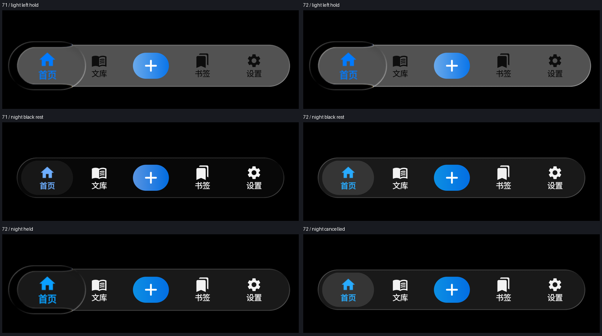
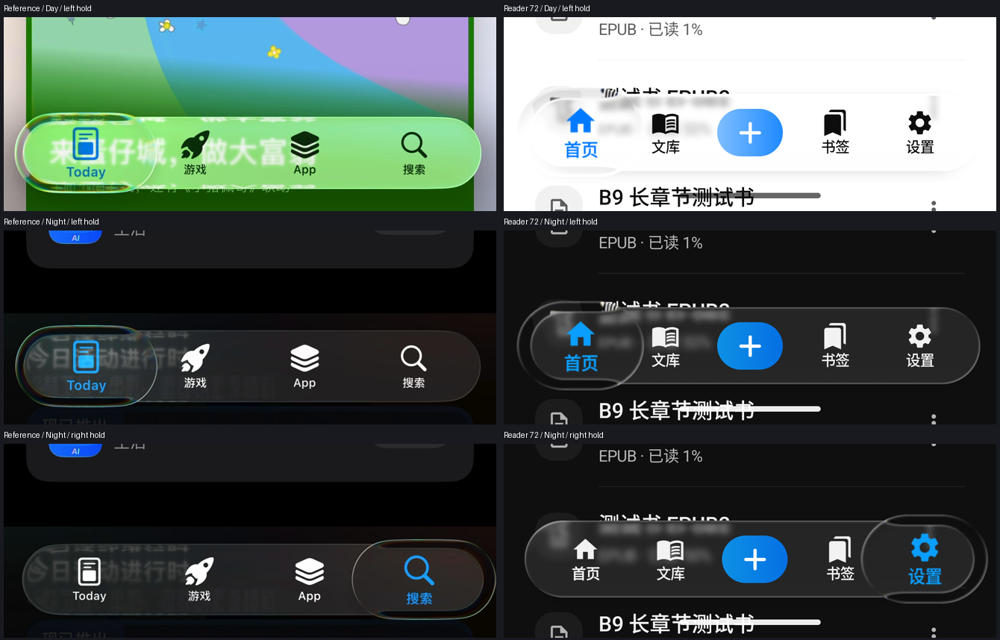

# iOS 日间 / 夜间 Dock 适配（72 版签名候选）

历史阶段报告：72 版解决了日夜色阶与浅色端帽对比，但用户随后明确反馈“折射和色散没有做到位”，又指出点击 Tab 的切换动画不足。本报告中的通过项不能作为完整视觉验收结论，后续见 [光学与点击动画修正](DOCK_OPTICS_20261013.md)。

本次按用户提供的两段 [iOS App Store 新标准](IOS_MATERIAL_STANDARD_20261013.md)适配实际 Dock。四个入口及中央导入动作继续服务 Reader；独立玻璃工作台维持删除。

## 实现与根因

- 夜间旧轨道在纯黑上为 RGB 8，紧凑选中态约 RGB 23，均比新参考的炭灰轨道 / 灰色选中态暗。保留 22% 叠色透明度，将夜间轨道叠色调整为中灰；实际黑底轨道为 RGB 25，紧凑选中态为 RGB 53。这里的中灰是叠色参数，不是实心底栏颜色。
- DockLens 的夜间静止叠色由 6% 调至 12%，按住仍收为 0；修正该值被公共 SelectionLens 默认值覆盖的角色映射。扩大透镜直接采样实际轨道，避免按住后增加灰块或整栏发白。
- 浅色真实轨道的高光强度由 0.60 调至 0.90，宽度仍为 0.75dp；真实端帽在小比例投影与浅折射之后保有足够局部对比。未补画内轨道，未扩大色散带。原 .08 峰值 / 60% 行数断言保留，左端满足要求的行数由 16/42 提升到 38/42。
- 夜间选中蓝色调整为接近参考的明亮蓝色。未选中图文继续近白色；局部变色、前景约 1.2 倍放大、按住形变、整栏跟随与释放 / 取消路径继续由原有实现负责。
- PDF 控件、面板和其他紧凑分段控件的材质参数保留。未增加依赖，未更改数据库、阅读或导航逻辑。

上述 RGB 来自相同 1080px / 420dpi 原生黑底场景的固定空白采样点，不是对所有背景的颜色承诺。参考视频存在压缩与采样误差，不从截图反推精确透明度或触摸时序。

## 验证

材质候选定向 QA 123 项 / Release 94 项均通过；Release lint 0 错误、170 警告、4 提示。候选原生 Dock 32/32 通过。使用同一测试 APK 在旧 71 材质上复现三项失败：浅色左端轮廓、左端空间、夜间黑底层级；新版三项均通过。原断言和阈值没有放宽。

最终候选结果如下；源码检查绑定 534 个应用 / 测试 / 配置文件，最终 QA 原生测试与签名 Release 使用同一材质源码。

| 层级 | 实际证据 | 结论 |
|---|---|---|
| implemented | 日夜轨道 / 选中层级、夜间蓝色、浅色真实端帽轮廓 | 已实现 |
| automated_verified | 全量 QA 1,780 项、Release 1,637 项；均 0 失败 / 错误，各 2 项既有环境跳过 | 通过 |
| automated_verified | Release lint 0 errors / 170 warnings / 4 hints；签名构建成功 | 通过 |
| device_verified，API35 模拟器 / QA | 最终 72 原生 32/32，152.233 秒；同一最终测试 APK 在旧材质上三项均失败 | 通过 |
| device_verified，API35 模拟器 / 正式包 | 71 → 72 保留数据升级；日夜两端 / 中央按住、局部切色、跨栏与往返、停住 / 松手、导入取消 | 通过 |
| reference_review，模拟器 | 正式日夜录屏按 8fps 采样检查，左右端与日夜参考配对查看；黑底、冷暖背景实际像素均核对 | 已执行，背景及入口数量不同，不是逐像素等同证明 |
| pending，物理手机 | 手机未连接，手机安装、屏幕实际颜色、连续触摸手感与用户最终观感 | 待验收 |

两项跳过为外部老子夹具未挂载及环境不支持符号链接，未新增跳过条件。原生保留原 29 项，增加夜间黑底 / 选中 / 取消恢复及日夜按住透色共三项；旧阈值和断言不放宽。最终测试 APK SHA-256：2daa2f15db689d78c7d5e037e88de15014315a8c7982be8b83c3407e8f256cf7。没有修改应用源码来配合最后的录屏采集。

## 签名产物与交付

[本次正式签名 APK](../.external_outbox/m1racle-reader-release-latest.apk)，版本 1.0.0 / 72，27,121,558 bytes。SHA-256：c82688159dbe9dbce68a5fb7da3bdd7305a6e0f63a3b5778c89acc32c6be219e。快照：m1racle-reader-release-v1.0.0-20261013-221210.apk。

生产证书连续，16 KiB 对齐检查通过；原生库逐文件摘要与旧正式包相同。Manifest 为 minSdk31 / targetSdk35、无 INTERNET，保留 profileable android:shell=true 供诊断。构建输出、Outbox、模拟器已安装 APK、Download 及 Download 回读的摘要一致。升级前后 firstInstallTime 均为 2026-10-03 06:05:17；无卸载或清库，instrumentation 始终只针对 QA。

模拟器 Download：/storage/emulated/0/Download/m1racle-reader-release-latest.apk。结束恢复密度 420、夜间 no 及正式应用首页，主包崩溃缓冲未发现本次崩溃。物理手机交付仍 pending。

## 实际画面对照

同一黑底原生场景的 71 / 72 对照：

原参考与正式 72 的日夜左右端对照。两者页面内容、图标及四入口 / 五槽布局不同；保持原始采样内容，没有重绘背景，不据此给出逐像素匹配分数。

[正式日间录屏](../../output/ios-material-adaptation-20261013/light-dock-motion.mp4) · [正式夜间录屏](../../output/ios-material-adaptation-20261013/dark-dock-motion.mp4) · [日间关键帧](../../output/ios-material-adaptation-20261013/light-motion-contact.png) · [夜间关键帧](../../output/ios-material-adaptation-20261013/dark-motion-contact.png)。采样时间标签有诊断窗口误差，不用于推导未知触点或精确弹簧时序。

## 过程异常与处理

首轮定向单测发现 DockLens 夜间叠色仍被公共默认值覆盖，已修正角色映射；其他失败为旧配方数值契约，按本次用户授权的新标准同步，原生像素阈值保留。全量首轮另发现 ReaderChromeTokensContractTest 仍要求旧 .60 浅色 Dock 高光，已更新为新配方后完整复跑通过。失败日志与结果 ZIP 均保留。

首次 Download 覆盖保留了旧包尾部 10,440 bytes，回读证明新前缀正确、尾部来自旧 71；该下载副本不是有效 ZIP。电脑正式包及安装源始终正确。最终采用新临时文件上传、摘要校验后替换，再回读并验证，与正式产物一致；损坏副本仅保存于本机证据目录并明确标注 invalid。

首次录屏裁切使用的 FFmpeg 不含 libx264，未完成夜间采集；已切换到本机现有、已确认含该编码器的版本，完整重新采集日夜及导入取消。仅修正采集工具，未重构或重新调整应用材质。

## 证据与边界

证据目录：工作区 output/ios-material-adaptation-20261013。包含修改前完整源码 ZIP、逐文件摘要、旧 Release / QA、候选失败及修正日志、定向单测结果、旧版负向验证、原生像素与前后对照。

本轮自动化与画面对照属于模拟器证据；物理手机未连接，手机安装、屏幕实际颜色和触摸手感尚未验收。没有 commit / push。
