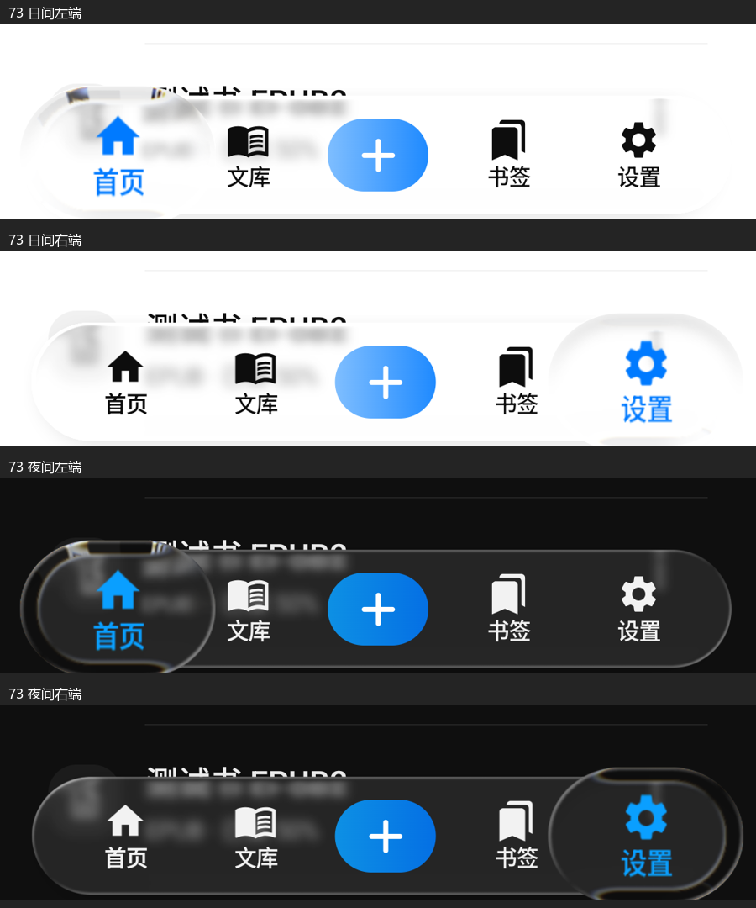

# Dock 折射、细色散与点击转场修正

用户指出 72 版折射和色散不足，并补充点击其他 Tab 的切换动画缺失。本次继续以两段 [iOS 日夜原视频](IOS_MATERIAL_STANDARD_20261013.md)为标准；72 的日夜色阶验证属于阶段证据，不能代替光学及用户观感验收。

## 根因与实现

实际链接的 Backdrop 2.0.0 将色散强度乘以横纵位置的乘积，上下中点及左右中点因而趋近于零。增加全局强度无法修复零点。来源已由本地依赖字节码及 [上游固定版本源码](https://github.com/Kyant0/AndroidLiquidGlass/blob/65ab177e90e5c1d8c62e70cf7755841982da65f6/backdrop/src/commonMain/kotlin/com/kyant/backdrop/internal/Shaders.kt)交叉核对。

[DockRefraction](../app/src/main/java/com/m1racle/reader/ui/material/DockRefraction.kt)保留上游圆角 SDF、圆弧折射和七波段重建，移除该乘积衰减。它仍是实际内容的一次光学采样，位移进入镜片中央时平滑归零。缓存 RuntimeShader，接在已有模糊 / 色调处理之后，仅用于 DockLens；PDF 及紧凑 SelectionLens 保留库原路径。依赖版本未变；源文件保留 Apache-2.0 版权及修改声明，仓库和应用内 notice 同步说明派生来源。

按住折射带 12→16dp、位移 5→8dp，色散强度 0.08→0.05。旧峰值参数受位置衰减，数值较大仍不代表边缘可见。新配方的局部红紫最远采样间距为 0.8dp，保留原亚 dp 配方上限和棋盘背景“彩色像素少于边缘区域 12%”断言。真实轨道满按住时等比投影高度 50→48dp，为增强折射保留独立内轮廓及两端空间。前景仍使用真实捕获并局部放大，未增加替代轨道或第二光谱层。

[OpticalDockTabs](../app/src/main/java/com/m1racle/reader/ui/hub/OpticalDockTabs.kt)原来在 DOWN 事件把预览位置直接设为目标 Tab，导致点击时透镜瞬移。现在记录实际起点，按拾起进度连续移动；短点击释放从已渲染位置续接原有弹簧。导航仍在 UP 后提交一次。页面原有 8% 短滑动保留，进入 / 退出改为共享的 220 / 180ms 节奏；真实 NavGraph 增加可定位页面根节点，验证前进及保存状态后返回首页。

## 验证记录

本轮于2026-10-13发起、2026-10-14交付73。候选失败、冻结源码、编译类、最终像素和正式录屏保存在工作区 output/dock-optics-20261013。物理手机未连接。

首轮 16dp / 8dp / 0.04 通过定向端帽、文字与细色散检查；新增色散检查初始采样从 0.8dp 开始，漏掉了亚 dp 外唇，按现有光谱测试一致改为从 0.3dp 采样，颜色和能量断言保留。0.055 候选在完整原生检查中 33/34 通过，棋盘边缘彩色面积 868/6972 超过原 12% 上限；实现收为 0.05，未修改该上限或其他原有像素断言。新增测试还检查短点击中间帧，旧版必须被拒绝。

## 最终验证与交付

| 层级 | 结果 | 边界 |
|---|---|---|
| implemented | 单次实际折射、连续细色散、等比内轨道、点击连续移动、页面220/180ms短滑动淡入淡出 | Dock/Tab源码已固定 |
| automated_verified | 全量QA 1,780、Release 1,637，均0失败/错误、各2项既有环境跳过 | 原始全量XML在后续定向运行前已归档 |
| automated_verified | Release lint 0 errors / 170 warnings / 4 hints，正式签名构建成功 | lint在共享工作区执行，独立顶栏同时有改动，不能由此宣称当前整个工作区已冻结验收 |
| device_verified，QA/API35 | Dock35/35，196.36秒；实际NavGraph前进/返回1/1，13.09秒 | 共36项，原有像素阈值保留 |
| negative_verified | 同一最终使用测试APK在旧QA72上3/3根因检查失败 | 日夜轴线色散为0；短点击中间帧已瞬移到目标；无接口异常代替断言 |
| device_verified，正式73/API35 | 日夜两端/中央、局部切色、双向拖动、释放、全部Tab点击返回首页、导入取消 | 实际录屏与关键帧已查看 |
| pending | 物理手机颜色、连续触摸手感、用户最终观感 | 模拟器不替代手机验收，不宣称与iOS逐像素等同 |

两项既有跳过是外部老子夹具未挂载和环境不支持符号链接，未新增跳过或放宽原有光学阈值。最终使用测试APK SHA-256：bf0f5b84d911c382e2c0e8aa16ea383e3ec0660ff1223dcf5e3c6899e03d7a45。该APK是并行顶栏任务后续生成的测试包；本次只执行其中源码摘要与73冻结归档一致的Dock/NavGraph类，顶栏用例未执行，不将它冒充先前focus3的完整匹配测试快照。

[73正式签名APK](../.external_outbox/m1racle-reader-release-v1.0.0-20261014-002640.apk)：1.0.0/73、Room17，27,121,682 bytes。SHA-256：111941442303ae681e2405e646ac22b0f820f8522817189ae7c6943442d204e9。生产证书连续，16KiB对齐通过，minSdk31/targetSdk35、无INTERNET，保留profileable shell=true；native库与72逐文件摘要相同。Outbox、冻结副本、Download、回读和安装源摘要一致。

本次实际启动的模拟器已安装包为71，按实际71→73保留数据升级记录，firstInstallTime前后均为2026-10-03 06:05:17。此前72验收属于此前设备状态，不据此把本次升级写成72→73。无卸载/清库，instrumentation始终只针对QA。结束时night=no、density420、正式应用首页，无本次主包崩溃；设备独占窗口已交还顶栏任务。

## 画面与参考核对

日夜实际按住画面：折回的是捕获到的真实轨道、页面文字与背景边线；中央图文保持清晰，端帽保留独立空间。与原日夜参考分别查看；页面内容和入口数量不同，只比较光学关系和运动，不提供匹配分数。

[原生黑底前后对照](references/ios-app-store-20261013/optics-before-after.png) · [日间拖动](../../output/dock-optics-20261013/light-dock-motion.mp4) · [夜间拖动](../../output/dock-optics-20261013/dark-dock-motion.mp4) · [日间点击页面转场](../../output/dock-optics-20261013/light-tab-taps.mp4) · [夜间点击页面转场](../../output/dock-optics-20261013/dark-tab-taps.mp4)。

[日间页面中间帧](references/ios-app-store-20261013/light-tap-page-contact.png) · [夜间页面中间帧](references/ios-app-store-20261013/dark-tap-page-contact.png)。录屏按20fps采样查看点击过渡，按8fps采样查看拖动；时间标签不用于推导物理触点或精确弹簧时序。

## 并行源码与构建边界

73的冻结源码归档包含536个应用/测试/配置文件，摘要逐项核对；对应签名APK、原始编译类及全量单测XML另存。新Dock shader完整字符串已在签名APK的classes.dex中逐字节验证。编译类证实73仍使用旧ProgressiveChromeBlur.apply(scope,float)与旧0.90/16dp顶栏配方。

签名构建期间，另一个用户授权的Markdown渐进模糊任务修改了共享GlassMaterial中的ProgressiveChrome配方及阅读器/测试文件。交付前的整体源码检查拒绝将当前工作区与73等同。经用户明确授权协调后，双方约定73独立验收Dock/Tab；顶栏的新“按钮显隐不影响模糊”语义继续由 [顶栏任务](MARKDOWN_PROGRESSIVE_CHROME_20261014.md)验证并接续74。其源码被保留，没有回滚或混入73验收结论。

首轮完整构建在lint阶段因JVM本机内存分配失败退出，未当作成功包；已保留崩溃日志。使用更低堆内存的新进程复用相同源码的已通过单测，完成lint与签名构建，17分9秒。没有关闭检查或替换签名。源码、失败、候选及交付证据均保留，未commit/push。
