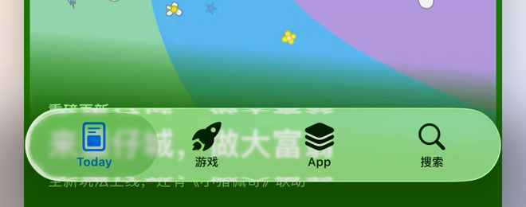
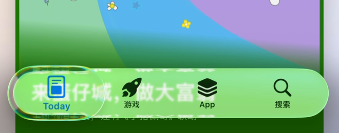
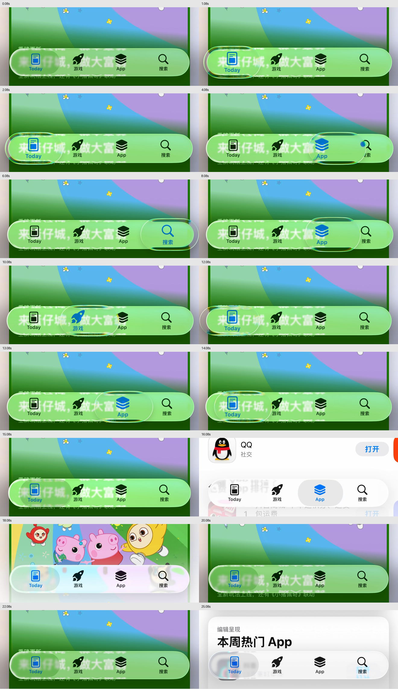
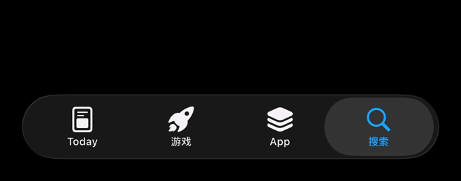
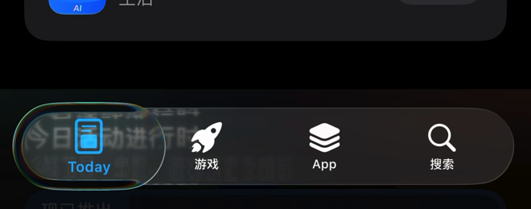
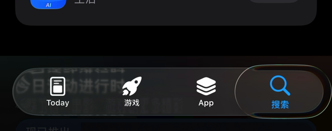
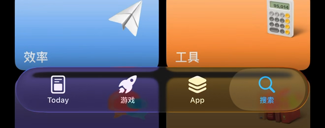
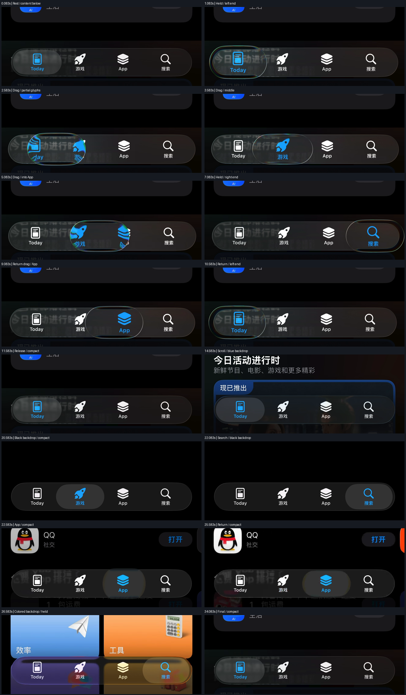
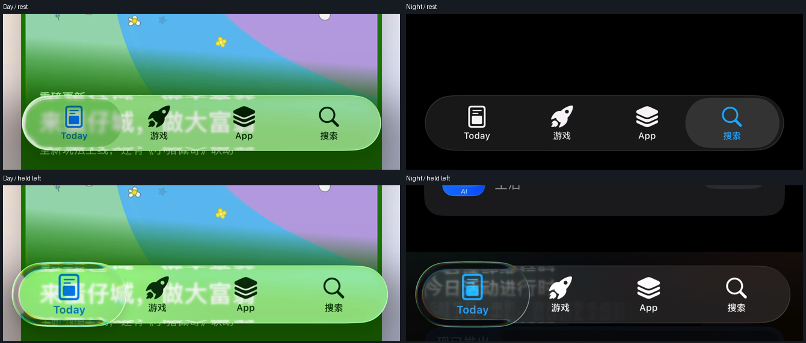

# Dock 材质与运动新标准：iOS App Store 日间 / 夜间（2026-10-13）

用户提供日间录屏并明确“参考这个，新标准”，随后补充“夜间的”录屏。两段共同定义浅色 / 深色目标。本页记录实际画面与验收要求，作为后续 Dock 视觉调整依据；不是已匹配声明。

## 参考来源

### 日间

原文件：a6e9a4e54d9769a868e4691d7fcfd10d_raw.mp4；原始位置为用户本机微信视频目录。原视频已保存在工作区 backups/references/ios-app-store-material-20261013.mp4，SHA-256：b1f4c18c60e57ed569c0e586f0244d84d0654fd50c978327194cca67dd78309d。

视频 26.068 秒，1320 × 2868、60 fps，展示浅色 iOS App Store 底栏在彩色插画、文字及白色卡片上的静止、按住、横向拖动、释放和页面切换。含音轨；本页只分析视觉画面。文档配图是原视频帧的底部裁切，没有重绘材质。

### 夜间

原文件：020dafcfccb77468785b6e20908cccdf_raw.mp4；备份为工作区 backups/references/ios-app-store-material-night-20261013.mp4，SHA-256：0cbf2bc7228c957220e9f7bb8877308e8117367bba084ebcc64cc6b860413639。

视频 34.403 秒，1320 × 2868、60 fps，74,184,687 bytes。画面为深色 iOS App Store，包含左右端按住外观、双向横移、收回、滚动、页面切换，以及纯黑、文字、蓝紫 / 橙黄色卡片背景。含音轨；本页只分析视觉画面。

两段原视频色彩标记均为 BT.709、全范围；截帧没有额外调色或 HDR 色调映射。下文“按住 / 松手”根据透镜扩大 / 收回的可见变化标注，视频没有显示可用于测量的触点，不能据此确认精确输入轨迹或取消手势。

## 逐状态标准

| 状态 | 视频可见特征 | Reader 验收要求 |
|---|---|---|
| 静止 | 整体为连续圆角玻璃轨道；选中区域较紧凑，呈柔和灰色 / 半透明背景，选中图文为蓝色 | 用实际内容采样形成材质；背景颜色仍能透过，选中态不做实心蓝块 |
| 按住 | 透镜沿横纵方向扩大，略超出轨道；内部图文放大，内外区域颜色不同 | 保持真实捕获与局部变色；图标和文字只出现一次，命中区域稳定 |
| 端帽 | 左右圆端仍有清楚的亮边和内部留白，透镜不只是模糊的半透明圆角矩形 | 两端分别对照参考，不用加画假的内轨道替代实际采样 |
| 折射 | 上下边缘折回真实轨道及文字；窄边可见微小色散，中央保留背景色 | 折射与色散沿实际边缘连续，不成为宽亮彩带；避免整栏发白 |
| 横向拖动 | 透镜连续跟随，经过图文时局部变蓝 / 放大；外部图文保持清楚 | 每帧跟随实际输入，捕获内容保持同步，避免重影和图标提前变回原色 |
| 松手 / 切页 | 透镜回到紧凑选中态；底栏与新内容衔接 | 单次提交导航，释放和取消各自复验；无残留放大层或返回闪白 |
| 背景变化 | 绿色插画下材质呈绿色；白底与文字卡片上仍能看到下层内容 | 至少覆盖彩色插画、文字和白底；不能只在纯黑 / 纯白测试底上判断透明度 |

Reader 的四个页面入口及中央导入动作继续服务自身功能；上表约束材质、采样和运动。日间与夜间须分别对照，参考视频覆盖两种外观不代表 Reader 已通过深浅色匹配、物理手机手感或手势取消验收。

## 日间关键画面

静止，约 0.08 秒：

左端按住，约 1.08 秒：

各位置、释放与背景变化：

配图来自 6 fps 诊断采样；时间标签是对应采样窗口中心，存在约一帧诊断采样间隔的定位误差。准确运动时序须回看原 60 fps 视频，不能从拼图推导精确弹簧常数、透明度或触摸轨迹。

## 夜间补充标准

| 项目 | 夜间视频可见特征 | Reader 验收要求 |
|---|---|---|
| 静止底色与图文 | 黑底上轨道呈深灰，细边界仍可辨；紧凑选中胶囊稍亮，选中图文蓝色，未选中图文近白色 | 保持深色层级及标签可读性；选中态沿用蓝色强调，不能整栏变亮或发白 |
| 内容透过 | 文字背景下能看到模糊的实际文字；彩色卡片下同一轨道左部偏蓝紫、右部偏橙黄 | 深色模式仍采样实际背景；分别检查黑底、文字与彩色内容，不能用固定深灰填充替代内容透过 |
| 按住与两端 | 扩大的透镜越过轨道上下边缘；左右端均保留弧形亮边与内部空间，中央维持暗色透光 | 两端单独复验形状、留白和底色；不能只改日间色值，也不能把按住态做成不透光灰块 |
| 折射与色散 | 透镜内文字和边缘发生弯折，薄边出现细小蓝绿 / 暖色色散，未覆盖整个透镜 | 保持真实内容折射、细窄边缘色散和清楚的内部图文；不扩成宽亮彩带 |
| 横移与图文 | 透镜跨过两入口时，可同时看到两侧图文的局部蓝色 / 放大；透镜外保持近白色 | 局部颜色和放大随透镜位置同步，保留过渡中的裁切；避免复制图标造成重影 |
| 收回与切页 | 扩大态收回为紧凑选中胶囊；纯黑页面和彩色卡片下均保留深色底栏 | 复验双向拖动、释放、切页及滚动后的底栏；取消行为另行实测，不能从视频推定已覆盖 |

夜间黑底静止，约 22.08 秒：

夜间左端、右端按住外观，分别约 1.08 秒、7.08 秒：

彩色背景透过，约 26.58 秒：

夜间逐状态对照；英文标签用于标记外观阶段，不代表已测得触摸事件：

## 日夜配对检查

以下为两段原视频的静止与左端扩大态，裁切区域及显示比例一致。两段背景内容、选中入口并不完全相同，拼图用于比较外观层级和透镜形态，不能直接相减得出透明度或匹配分数。

后续保存 Reader 的日间 / 夜间同场景画面时，每种外观至少覆盖静止、左端、中央、右端、双向拖动、释放 / 取消，以及黑白底、文字与彩色背景。分别记录图文对比、整栏底色 / 透过、端帽空间、细色散和运动连续性，不以日间通过代替夜间通过。

## 当前实现与验证边界

72 版调整夜间底色 / 紧凑选中层级和蓝色，增强浅色真实端帽轮廓，原生32/32通过，属于 [色阶与轮廓阶段证据](DOCK_IOS_ADAPTATION_20261013.md)。用户随后明确指出折射、色散仍不足，并补充点击其他 Tab 的切换动画缺失，不能把72的自动通过视为完整适配验收。

最新修正改进真实内容折回及边缘中点色散，补齐点击时透镜连续移动，调整实际页面淡入滑动节奏；具体实现和最终验证见 [光学与点击动画报告](DOCK_OPTICS_20261013.md)。参考与 Reader 内容和入口数量不同，不宣称逐像素等同。物理手机未连接，实机颜色、连续触摸手感和用户最终观感待验；保留现有光学断言，自动验证、模拟器、参考对照和物理手机结果分别记录。
