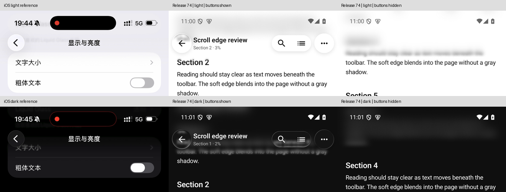
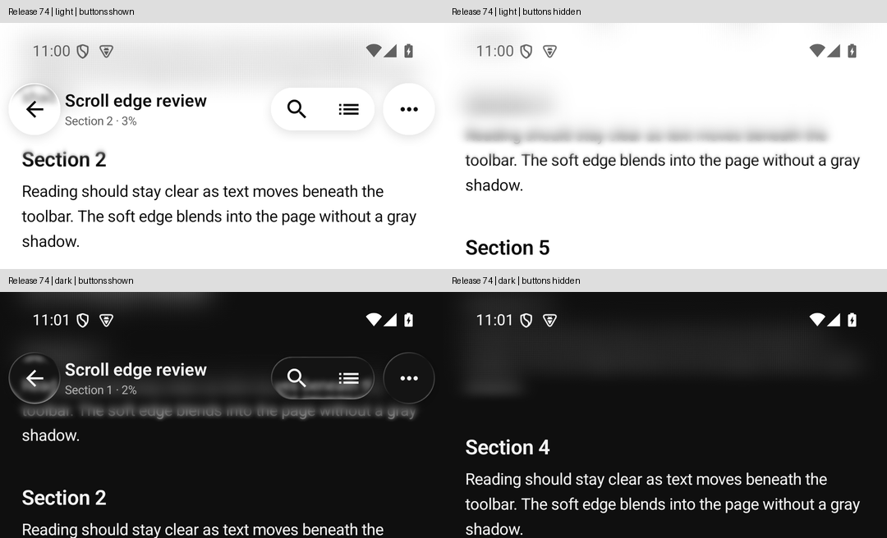

# Markdown 固定渐进模糊 — 1.0.0 / 74（2026-10-14）

参考两段 iOS「显示与亮度」日夜视频，完成 Markdown 顶栏从上方强模糊到正文清晰的连续过渡。按用户最后的要求，**按钮显示或收起均不改变模糊范围、强度和下缘位置**，只有前景按钮独立淡出。正式74包含已验收的73版 Dock/Tab 修改，并完成共同源码复验。

## 参考与实现

- 深色：`5f281c500098bb30316fa56f78020497_raw.mp4`，17.7秒；浅色：`7cb0ced938c1ba7d8c46233c779006c4_raw.mp4`，16.7秒；均为1320×2868、约60fps。视频仅作为视觉参考。
- 使用既有 Kyant Backdrop 捕获正文，标题和按钮独立绘制。状态栏后维持最大模糊，向下连续降低半径；页面色覆盖同时退去，正文颜色能透过材质。
- `GlassMaterialEngine` 的 `ProgressiveChrome` 配方改为32dp最大采样范围、浅色24% / 深色52%页面色覆盖。下缘衔接统一为32dp，顶栏容器和渲染共享尺寸。
- `readerGradient` 完全移除 `controlsVisibility` 输入，固定容器高度与深度曲线。滚动收起仅改变前景控件的透明度、位移和命中区域；搜索替换顶栏不改变正文布局。
- 两轴 Gaussian 各33点采样，避免大半径下出现重复文字轮廓；视口外采样延展首末像素，修正极顶部混入透明像素后漏出清晰正文的问题。
- API33+ 完整光学路径使用渐变半径；API31–32延续平台模糊加渐变遮罩，无采样能力时延续可读性保护。此次设备证据为API35，不扩大为旧系统实测。

主要源码：`ReaderGradient.kt`、`ProgressiveChromeBlur.kt`、`ViewerScreen.kt`、`GlassMaterial.kt` 的 ProgressiveChrome 配方。新增 `ReaderProgressiveChromeInstrumentedTest` 五项实际窗口像素检查；三项现有配方契约仅更新精确预期值，容差未放宽。

正式截图中正文位置随手势变化；“相同内容、相同位置”的严格对比由下述原生用例完成。

## 验证结果

| 层级 | 结果 | 证据边界 |
|---|---|---|
| implemented | 固定模糊及独立按钮收纳进入正式74 | 571个源码/配置文件冻结，签名DEX含最终shader；实际Release调用签名不再接收按钮可见度 |
| automated_verified：全量JVM | QA 1,780 / Release 1,637，0失败、0错误，各2既有环境跳过 | XML归档为 `full-Qa-results.zip` / `full-Release-results.zip`；本轮未新增跳过 |
| automated_verified：静态及构建 | Release构建成功；lint 0错误、170 warnings、4 hints | `release74-build.log`、`release-verification.json` |
| device_verified：QA原生 | **42/42**：Dock35、实际NavGraph1、渐进顶栏5、shader实际运行1 | API35、AMD硬件渲染；`native74-host-all.log` / `native74-shader-smoke.log` |
| device_verified：相同正文的按钮收纳 | 日夜均通过；指定背景区域收纳前后RGBA平均差均为 **0.0** | 实际 `ReaderTopBarOverlay`、窗口PixelCopy；`release74-fixed-visibility-pixel-proof.json` |
| device_verified：正式74 | 日夜上滑收起、反向展开、打开/关闭搜索通过；7个正文标题坐标不变 | `release74-*-motion.mp4`、对应UI树、`release74-search-proof.json` |
| device_verified：保留数据升级 | 模拟器73→74；firstInstallTime仍为2026-10-03 06:05:17；首页可见8个既有文档名称一致 | 未卸载或清数据；`device-release74.json` / `release74-library-proof.json`，不宣称全数据库逐条验收 |
| pending | 物理手机屏幕颜色、触摸时序及用户最终观感 | 当前仅连接模拟器 |

两项既有JVM跳过分别为外部老子夹具未挂载，以及符号链接环境限制。固定语义先完成89项定向JVM；其中两项滚动边缘类曾因增量编译产物缺失未被发现，经非增量编译恢复并实际执行通过，最终全量构建同样关闭增量编译。未删除测试、放宽断言或扩大容差。

### 根因负向验证与渲染环境

- 同一最终测试APK（SHA-256 `60def09415b40bde262298c5fc3adddbf332db391085c63a64fb56f2c0c36006`）在此前“按钮收起会缩短模糊”的QA包上，确实触发 `hiding controls must preserve the same blur` 断言；恢复固定语义后日夜通过。测试APK与最终74测试包逐字节一致。
- 厚页面色覆盖旧包触发实际透色断言；未延展视口边界的shader触发实际极顶部漏字断言；恢复后通过。第一次透色负向因新旧调用链接不匹配而失败的记录单独保留为 `native-negative-linkage-invalid.log`，不计作有效负向证据。
- 首次74原生矩阵在 SwiftShader 软件渲染下为40/41，Dock既有“彩边面积须小于12%”失败：843/6972。相同测试、旧73包和74包均得到同一失败数值。恢复73曾验收使用的 `-gpu host` 后，两包该项分别通过，最终74完整41项及额外shader1项全部通过；未改Dock实现或测试阈值。保留 `swiftshader*`、`host73-spectral.log`、`host74-spectral.log` 全部记录。

## 正式产物与交付

[正式签名74安装包](../.external_outbox/m1racle-reader-release-v1.0.0-20261014-061125.apk)，27,121,682 bytes；`latest` 指向同一产物。

SHA-256：`e0591c1f0a6fa20a55304129cf1debeccfd5471d653a3a16312f5dd44226e3b7`。

证书SHA-256：`2d9daba0f92c1d19d290dd58657391a71c16c3008e8a2b90065ba7e8602bf9d1`；证书连续、16KiB对齐，minSdk31 / targetSdk35，无INTERNET，保留profileable shell=true。原生库字节与73一致。

Outbox、冻结安装包、模拟器实际安装源、Download回读摘要一致，最终复核为 `release74-closeout.json`。设备文件为 `/sdcard/Download/m1racle-reader-release-latest.apk`；QA仅作隔离检查。结束恢复night=no、density420和正式应用首页；最后捕获的2000条日志中无正式主包致命崩溃记录。

本轮证据目录：[output/markdown-progressive-topbar-20261014](../../output/markdown-progressive-topbar-20261014/)，包含 `release74-source.zip`、`release-source-sha256.json`、编译日志、XML、安装回读、参考帧与日夜录像。73的历史光学报告保持原样；其设计背景见 [Dock报告](DOCK_OPTICS_20261013.md)。未commit/push；此任务不扩大为全部功能或全清单实机验收。

[Code Wiki](code-wiki/README.md)已按最终74源码重新生成并通过静态检查：20份文档、3142个相对链接、116个关键API名称，输入摘要 `13280503be106798d2f6cb836260d7ae1065c1a8aa16127ecbe86371ea5446fe`；文档检查与上述构建/设备证据分别成立。

## 本机模拟器存储调整

构建后D盘余量不足，模拟器冷启动被磁盘检查阻止。将原AVD数据复制到 `C:\Users\42899\Documents\Codex\2026-10-14\reader-emulator74\Suanming_Pixel7.avd`，逐个校验所有img/qcow2摘要后更新AVD指针，未删除原数据。原路径为 `D:\04_构建环境\Android 用户目录（.android，含模拟器 Suanming_Pixel7）\avd\Suanming_Pixel7.avd`；迁移证明和原指针/配置备份在证据目录。

当前指针仍经 `.build-tools/android-user/avd/Suanming_Pixel7.ini` 解析，采用冷启动及硬件GPU（1536MB、2核），避免加载旧RAM快照；这是本机环境调整，不进入APK。
