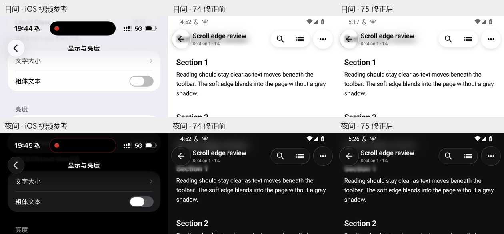
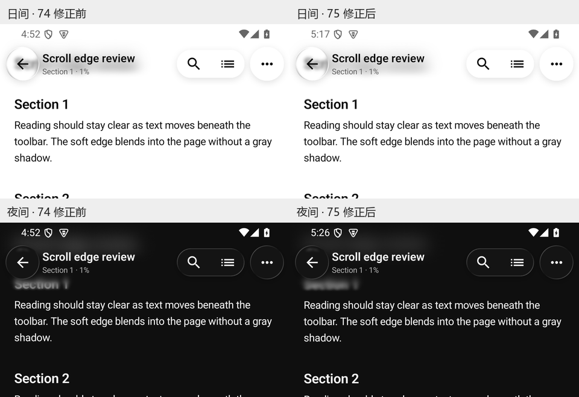
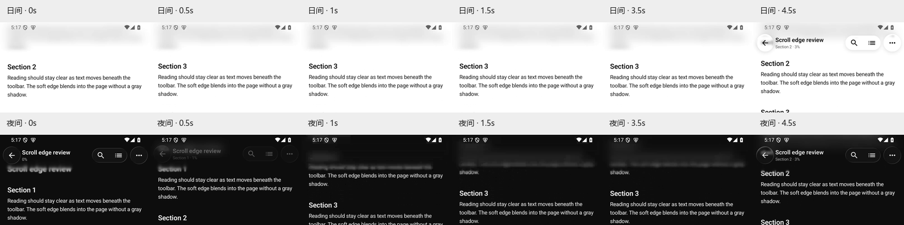

# Markdown 顶栏重影与条纹修正 — 1.0.0 / 75（2026-10-14）

用户指出74版Markdown顶栏观感很差，本轮重新检查所提供的两段日夜iOS参考视频，并在当前正式74包中复现。74的既有检查通过，不代表用户已认可视觉效果。本轮只修改顶栏渲染及相关回归，既有Dock、按钮布局、搜索、正文位置和数据结构保持。

## 观察和修正

1. **顶栏透底：已修正并核对。** 74在模糊半径已经递减的下缘又通过透明遮罩混入原始清晰正文，形成重影；33点的大半径采样还会把细笔画变成重复条纹。完整光学路径删除二次透明淡出，以模糊半径回到零完成衔接；采样数量随实际物理像素半径调整，常规密度下样本间距不大于一个像素，最多每轴257点。顶部页面色使用平滑深度曲线，保持上方安静并向正文释放颜色。
2. **按钮收起与展开：模拟器通过。** 模糊高度、强度和下缘仍固定，只有前景按钮变化。相同正文像素背景的日夜RGBA平均差均为0.0；正式75的日夜上滑收起、反向展开录屏及中间帧另行检查。
3. **搜索：模拟器通过。** 正式包打开/关闭搜索，正文标题坐标保持一致。标题、图标为独立清晰前景；加载/错误页、系统滚动捕获时的顶栏策略保留。

对照由本轮直接从用户提供的视频提帧，并现场捕获实际安装的74/75包。iOS和Android的标题、正文、窗口安全区不同，参考对照用于判断模糊与衔接，不宣称逐像素复刻整个iOS页面。触摸区域和辅助功能语义有现有回归；截图不能证明完整无障碍符合性。

## 根因回归

新增两项实际窗口PixelCopy测试，既有五项检查和阈值保持：

- 同一最终测试APK在74包上两项均失败：下缘清晰笔画残余对比度0.678；细笔画外围重复边缘0→0.0157。
- 在75包上全部7项通过；下缘测试线日间残余对比度0.286、夜间0.274，且细笔画扩散无重复侧影。
- 最初较迟退去的候选模糊曲线未通过既有日间深度断言；修正生产曲线后通过，未放宽断言。该中间候选未交付。
- 最终/负向测试APK逐字节一致，SHA-256：`891577725da31c04eae38378722936074756b9d489c38573c7e1570d8319a955`。

## 验证与边界

| 层级 | 本轮结果 | 边界 |
|---|---|---|
| implemented | `ReaderGradient.kt`、`ProgressiveChromeBlur.kt`及两项像素回归进入75 | 571个源码/配置文件冻结并核对；版本单调74→75 |
| automated_verified | QA 1780 / Release 1637，0失败/错误，各2既有跳过 | XML已归档；外部老子夹具和符号链接环境限制未扩大为通过 |
| automated_verified | Release构建成功，lint 0 errors / 170 warnings / 4 hints；签名与16KiB通过 | 正式签名证书连续，无INTERNET，minSdk31 / targetSdk35；保留profileable shell=true |
| emulator_verified | 49/49：顶栏7、Markdown阅读/选择/滚动捕获/Shader6、Dock35、实际导航1 | API35、硬件GPU；隔离QA包，未对生产包跑instrumentation |
| emulator_verified | 正式75日夜收起/展开与搜索位置通过，74→75保留数据升级 | firstInstallTime保持 `2026-10-03 06:05:17`；核对可见书库，未宣称逐条全数据库验收 |
| pending | 物理手机颜色、触摸时序、厂商系统及用户最终视觉认可 | 当前只有模拟器；API31–32仍使用原平台模糊降级，本轮新光学路径实际验证为API35 |

## 正式产物

[75正式签名安装包](../.external_outbox/m1racle-reader-release-v1.0.0-20261014-131608.apk)，27,121,682 bytes。

SHA-256：`2dec60bfcefb58d1e6b434652daf94e9f04d250f6a092e6b07e113123d4f0cf1`。

证书SHA-256：`2d9daba0f92c1d19d290dd58657391a71c16c3008e8a2b90065ba7e8602bf9d1`。本次构建输出、Outbox latest、冻结副本、模拟器安装源和Download回读摘要一致。模拟器Download为`/sdcard/Download/m1racle-reader-release-latest.apk`；物理手机安装/Download待连接后执行。生产包只以`install -r`更新，未卸载或清数据。

完整证据目录：[markdown-topbar-20261014](C:/Users/42899/.codex/.chatgpt-projects/g-p-6a544675b3348191882a4acf797c2267/output/markdown-topbar-20261014)，含571文件源码检查点、Git状态、XML、构建日志、相同测试APK的正负检查、安装回读、参考帧、正式截图和日夜录像。结束恢复日间与正式应用首页。未commit/push，不把本轮通过扩大为全功能物理手机验收。
