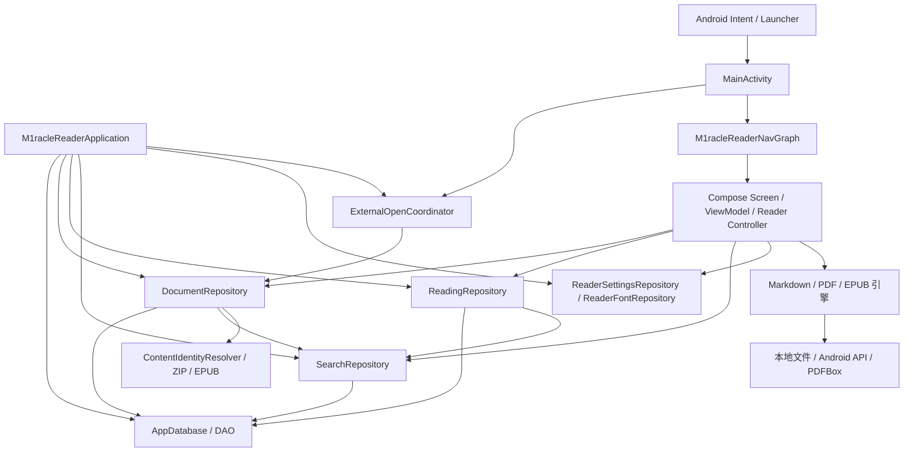

# 02 整体架构

[返回目录](README.md)

## 架构形态

工程采用单应用模块、Compose UI、ViewModel 状态容器、Repository 数据边界、Room/DataStore 本地持久化，并将格式引擎放在独立包内。没有独立后端服务，也没有 Hilt/Dagger 容器或一个统一的 UseCase 层。

[M1racleReaderApplication](../../app/src/main/java/com/m1racle/reader/M1racleReaderApplication.kt) 通过 `by lazy` 手动组装进程级对象。页面通过 `ViewModelProvider.Factory` 注入参数。以下图描述主要运行调用关系；包之间的全部显式依赖见 [包依赖参考](reference/package-dependencies.md)。

## 启动与依赖组装

| 对象 | 生命周期及职责 |
|---|---|
| `M1racleReaderApplication` | 进程级；创建 `applicationScope`，延迟组装数据库、仓库、设置、字体和外部打开协调器 |
| `applicationScope` | `SupervisorJob + Dispatchers.IO`；支持页面销毁后最终进度写入和异步资源关闭 |
| `AppDatabase` | 进程单例；提供全部 DAO 与 v1→v17 迁移链 |
| `MainActivity` | Activity 级；处理启动和新 Intent、系统栏、刷新率、Compose 根节点、导航确认 |
| 各阅读器 ViewModel | 阅读会话级；按 documentId 加载内容、维护状态、调度解析/渲染/保存 |
| Compose `remember` 对象 | 页面组合生命周期；控制器、滚动/分页状态、手势和采样节点 |

`Application.onCreate()` 在 IO scope 中依次尝试 `sidecarIdentityMigration.ensureCompleted()` 与 `documentRepository.recoverPdfSourceWrites()`。导入入口还会确保身份运行准备完成，不能只依赖后台启动任务的时序。

## 状态与事件

UI 主要从 `StateFlow`/`Flow` 订阅稳定状态，再把操作交给 ViewModel 或控制器。单次反馈使用事件流；外部导航例外地保存在待确认的 `StateFlow`，直到 Activity 调用 `ackNavigation(requestId)`。

| 状态 | 生产者 | 消费者/作用 |
|---|---|---|
| `HomeUiState` | `HomeViewModel` 组合最近文档与导入状态 | Home 列表、继续阅读、导入反馈 |
| `ViewerUiState` | `ViewerViewModel` | Markdown Loading/Success/Error |
| `DocumentSearchUiState` | `ViewerViewModel` | 文内搜索输入、结果、当前命中 |
| `PdfViewerUiState` | `PdfViewerViewModel` | PDF Loading/Ready/Error 与页面资源 |
| `EpubUiState` | `EpubReaderViewModel` | EPUB 加载、解析成功与拒绝原因 |
| `SearchUiState` | `SearchViewModel` | 跨文档搜索结果 |
| `pending`/`busy`/`pendingNavigation` | `ExternalOpenCoordinator` | 外部打开确认、提交与原子替换阅读器 |
| 阅读设置 Flow | `ReaderSettingsRepository` | Markdown/EPUB 排版与字体配置 |

UI 临时选择区、菜单动画、手势预览、玻璃按压参数是会话态，不是持久阅读位置或内容身份的第二来源。

## 三类权威

1. **内容身份：**实际源字节的 SHA-256。`ContentIdentityResolver` 提供暂存候选，`DocumentRepository.commitResolvedImport()` 在事务中再次判定并绑定 UUID 文档 ID。URI 只描述位置。
2. **阅读位置：**`documents` 行中的位置字段族。`ReadingRepository` 管理书签、收藏、高亮、笔记；不维护另一份阅读进度表。
3. **视觉材质：**`ui/material` 的引擎与样式解析职责。页面使用角色、环境和能力表达需求；采样内容和采样控件必须具有正确的组合拓扑。

## 线程与异步边界

- Compose、指针输入和导航在主线程；重型文件操作、解包、哈希、PDF 打开/渲染/保存转入 IO。Markdown 解析与搜索的 CPU 工作在 ViewModel 后台调度中执行。
- `PdfPageRenderer` 用 `Mutex` 串行化原生 renderer 的访问。不能把高频手势更新直接等价为同步渲染。
- `LatestViewportConflator` 保留最新视口，`TileWorkQueue` 按优先级调度；结果通过 document/geometry generation 校验后才发布。
- `ReadingPositionSaver` 串行合并普通位置更新，最终 flush 使用独立的不可取消 IO scope；定时防抖由调用层决定。PDF 使用 `FinalPdfProgressFlusher` 和应用级 scope，避免 `viewModelScope` 取消后漏写或关闭失败。
- 文件与数据库不能天然共用一个事务；PDF 源文件写入通过备份、日志票据、哈希验证和恢复弥合此边界。

## 实际分层边界

主要 UI 业务写入经过 Repository/Controller；但不宜宣称工程满足严格 Clean Architecture：`DocumentRepository` 直接调格式引擎，`BookmarkTarget` 引用了 PDF 视口模型，部分 UI 直接使用文件与文档工具，材质模块依赖 Android/Compose。手动工厂和 Application 的类型转换也属于实际组装方式。

修改前先追真实调用者和测试。维护 PDF 需同时考虑 UI→几何→渲染→保存；维护导入需同时考虑哈希→事务→文件所有权→取消；这些横向契约不能只按目录拆开理解。
