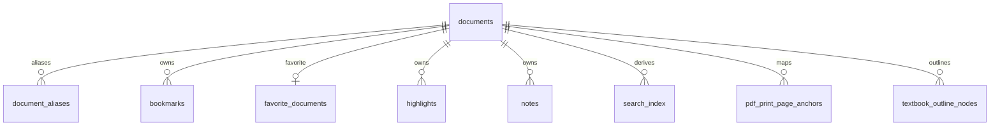

# 03 数据、持久化与锚点

[返回目录](README.md)

## 数据库结构

[AppDatabase](../../app/src/main/java/com/m1racle/reader/data/local/AppDatabase.kt) 是 Room v17 数据库，显式注册 v1→v17 迁移，没有配置破坏性迁移兜底。完整字段、主键、索引、外键来自 [v17 数据库字典](reference/database-schema.md)。

| 表 | 职责与关键字段 |
|---|---|
| `documents` | 文档 ID、显示名、读取 URI、类型、内容哈希、源 URI/哈希、最近打开时间与全部阅读位置字段 |
| `document_aliases` | `aliasKey` 到 `documentId` 的位置别名；记录 kind、创建与最近验证时间 |
| `bookmarks` | 固定阅读快照；位置类型、location、offset、标题、备注与编码 anchor |
| `favorite_documents` | 每文档一条收藏关系及创建时间 |
| `highlights` | 文档内高亮，canonical anchor、位置投影、摘录、颜色样式 |
| `notes` | 文档内笔记，canonical anchor、位置投影、正文、创建/更新时间 |
| `search_index` | 文档标题/高亮摘录/笔记正文的派生索引；不是全文数据库 |
| `pdf_print_page_anchors` | PDF 零基页索引到印刷页号的校准锚点 |
| `textbook_outline_nodes` | 教材目录节点、层级、起止页、排序和导入来源 |

子表的文档外键为 `ON DELETE CASCADE`。目录的 `parentId` 是业务树关系，不能仅根据 ER 图推断它另有数据库自关联外键。

## Repository API

| 类与入口 | 输入/输出与关键行为 |
|---|---|
| [DocumentRepository](../../app/src/main/java/com/m1racle/reader/data/repository/DocumentRepository.kt) `observeRecentDocuments()` | 输出最近文档 Flow，驱动 Home/Library |
| `importDocument(Uri)` | 系统选择导入；返回 `ImportResult`，区分成功、不支持、超限、读取失败 |
| `commitResolvedImport(ResolvedImportRequest)` | 提交已暂存且哈希验证的内容，返回最终文档及 `reusedExisting` |
| `readDocumentText(uriString, expectedContentSha256)` | 读取受限大小文本；可验证当前内容与已记录身份一致 |
| `renameDocument(id, name)` | 改书库显示名，保留身份、位置和阅读资产；不重命名用户源文件 |
| `exportDocument(id, target)` | 导出完整文件到明确的目的 URI |
| `deleteById(id)` | 事务删除记录及相关派生数据，再清理无其他引用的应用私有副本 |
| `updateReadingPosition()` / `updateEpubReadingPosition()` | Markdown/EPUB 位置持久化 |
| `updatePdfProgressSnapshotAtomic()` | 在一个 Room 事务中保存 PDF 阅读位置和视口快照 |
| `saveDocumentEdits()` / `recoverPdfSourceWrites()` | 提交有限正文编辑及恢复未完成的外部源写入 |
| [ReadingRepository](../../app/src/main/java/com/m1racle/reader/data/repository/ReadingRepository.kt) | 书签/收藏/高亮/笔记门面，高亮与笔记更新同步维护搜索派生行 |
| [SearchRepository](../../app/src/main/java/com/m1racle/reader/data/repository/SearchRepository.kt) `index()` / `search()` | 三种索引来源，查询可限定文档，默认 50、最大 200 条 |

`RepositoryTransactionRunner` 提供可替换事务边界，生产实现调用 Room `withTransaction`，便于测试真实的复合写入语义。

## 文档实体中的位置权威

| 格式 | 持久字段 | 含义 |
|---|---|---|
| Markdown/Markdown 包 | `lastScrollIndex`、`lastScrollOffset`、`readingProgress` | 解析后块列表的可见项索引及像素偏移 |
| PDF | 同上 + `pageCount` | 零基 PDF 页索引、编码页内比例及进度 |
| PDF 视口 | `pdfViewport*`、`pdfPageAnchor*` | 模式、页、归一化页内/视口锚点、缩放、generation |
| EPUB | `readingAnchor`，并保留行/偏移/进度 | `epub:` 文本锚为恢复权威；旧字段供缺失章节等情况下退化恢复 |

阅读进度与书签不同：进度随继续阅读更新，`BookmarkTarget` 拥有创建时捕获的位置；不能用最新进度替代书签目标。

## 跨格式锚点

[DocumentAnchor](../../app/src/main/java/com/m1racle/reader/data/anchor/DocumentAnchor.kt) 是密度和渲染分辨率无关的定位模型。

| 类型 | 定位信息 | 使用场景 |
|---|---|---|
| `PdfPage` | `page`（零基）+ 多个 `NormalizedRect` | 整页书签、逐行高亮、笔记定位 |
| `MarkdownBlock` | 解析块索引 + 可选字符半开区间 | 段/块定位、精细高亮 |
| `EpubText` | `spineHref`、章内块序、字符偏移、解析规则版本、quote | 字号/行距变化后的 EPUB 位置恢复 |

[AnchorCodec](../../app/src/main/java/com/m1racle/reader/data/anchor/AnchorCodec.kt) 负责编码/解码；[AnnotationAnchorResolvers](../../app/src/main/java/com/m1racle/reader/data/anchor/AnnotationAnchorResolver.kt) 负责将 anchor 投影为 `locationKind/location/encoded`，以及解析旧行。`kind/location` 是查询投影，编码 anchor 提供精确语义。

`NormalizedRect.fromPixel()` 将像素转为归一化坐标。直接构造只校验宽高非负；`normalized()` 才钳制各分量，不能把注释中的“构造即钳制”当作实现保证。

[BookmarkTarget](../../app/src/main/java/com/m1racle/reader/data/anchor/BookmarkTarget.kt) 封装 anchor、scrollOffset 和可选 PDF viewport，`encode/decode` 用 JSON 保存快照，`applyTo()` 为打开 PDF 生成带指定视口的位置数据。当前模型支持 EPUB 锚不等于 EPUB 页面已完整接入书签/高亮 UI。

## 搜索索引与事务

`SearchIndexDao` 使用普通表与 `LIKE ... ESCAPE '\'` 查询；没有 FTS 虚表或正文倒排索引。Repository 转义 `%`、`_` 和反斜线，防止用户文本成为通配模式。结果按 DOCUMENT → HIGHLIGHT → NOTE 分类排序，再按时间与稳定键排序。

高亮/笔记的新增、更新或删除和对应搜索行在同一 `transactionRunner.run` 中执行。标题更名与文档索引也由文档仓库维护。UI 不应另写派生索引。

## 设置、字体与文件

- [ReaderSettingsRepository](../../app/src/main/java/com/m1racle/reader/data/settings/ReaderSettingsRepository.kt)：Preferences DataStore `reader_settings`，保存字号、行距、边距、EPUB 字族/阅读模式/导入字体 ID；I/O 异常发出默认值，其他异常继续抛出。
- `ReaderSettings`：字号范围 0.9–1.2；行距范围 1.20–2.00；默认行距 1.55。保存和读取均经过 clamp。
- `ReaderLineHeightMigration`：一次性迁移历史行距值。
- [ReaderFontRepository](../../app/src/main/java/com/m1racle/reader/data/settings/ReaderFontRepository.kt)：导入/删除字体，最大 50 MiB，使用本地私有文件及内容 ID；删除选中字体时同步清除设置引用。
- `files/library`：普通文档受控读取副本；`files/packages`：Markdown 包；`files/epubs`：EPUB 资源目录。更多临时/恢复目录见格式章节及源码索引。

## 数据迁移要点

迁移的目的为保留用户数据，不是保留废弃运行架构。重要节点：v5→6 PDF 视口字段；v6→7 内容哈希；v7→8 阅读资产；v8→9 删除冗余 `reading_states`；v9→10 高亮/笔记；v10→11 canonical anchor；v11→12 搜索；v12→13 URI 别名及受约束哈希回填；v13→14 源 URI/哈希；v14→15 EPUB 与书签 anchor；v15→16 高亮样式；v16→17 回填旧高亮/笔记缺失的 anchor，并同步修复对应搜索行。v17 是数据修复，不改变表结构。

Room schema 从 v6 起导出，v1–v5 没有可凭空补出的快照。迁移测试及当前索引定义见 [测试篇](11-testing-and-troubleshooting.md) 和 [字典](reference/database-schema.md)。
