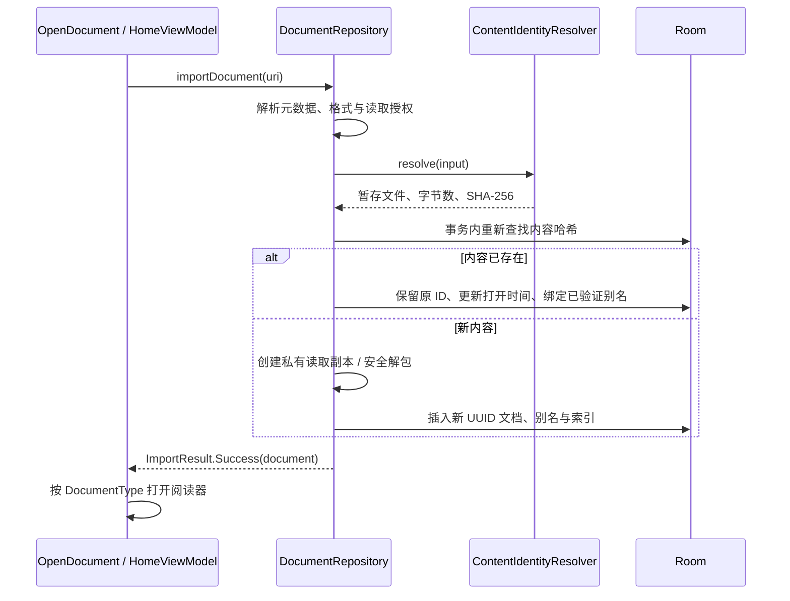

# 04 导入、身份与外部打开

[返回目录](README.md)

## 统一内容身份

文件名、URI 和用户可见标题都不是内容身份。实际读取的源字节 SHA-256 才是 `documents.contentSha256` 的去重依据；该列具有唯一索引，历史 NULL 值需要先做一次性身份补全。

[ContentIdentityResolver.resolve(ContentIdentityInput)](../../app/src/main/java/com/m1racle/reader/identity/ContentIdentityResolver.kt) 的职责是：检查大小提示、把输入流复制到私有暂存文件、在复制时计算实际字节数和哈希、查询现有内容候选，再返回 `PreparedContentIdentity`。它不提交 Room、不创建最终 documentId、不改变活跃阅读器。

`PreparedContentIdentity` 拥有暂存文件的生命周期；调用者必须提交或关闭。取消、超限、异常路径删除本次暂存文件。`decision` 只是提交前观察，不是并发导入下的最终判定。

## 系统选择导入

`DocumentRepository.commitResolvedImport()` 使用导入互斥锁，在 Room 事务内重新查询哈希；唯一约束竞争最多尝试 3 次。只在确定新内容后生成 UUID，不使用 REPLACE 替换已有文档。相同字节复用 ID，从而保留书签、高亮、笔记、位置与目录子行。

普通 Markdown/PDF/EPUB 会物化到 `files/library/<hash>/<id>/<安全文件名>`。Markdown 包解压到 `files/packages/<id>`，读取 URI 指向入口 Markdown。EPUB 原包与提取资源分开保存。应用持有稳定读取副本，`sourceUri/sourceSha256` 另行描述外部源，尤其用于 PDF 防冲突写回。

## 格式、元数据与授权

| 入口/类型 | 职责 |
|---|---|
| [DocumentType](../../app/src/main/java/com/m1racle/reader/data/local/DocumentType.kt) | `isAllowedImport()` 与 `resolve()` 综合 MIME、文件名和路径；生产格式 MARKDOWN/PDF/EPUB/MARKDOWN_PACKAGE |
| [ExternalUriMetadata](../../app/src/main/java/com/m1racle/reader/share/ExternalUriMetadata.kt) | 解析显示名、大小和 MIME，避免将缺失的大小误当作零 |
| [ProviderMetadataSource](../../app/src/main/java/com/m1racle/reader/share/ProviderMetadataSource.kt) | 隔离 provider 元数据读取，支持测试异常或冲突来源 |
| [ExternalIntentUri](../../app/src/main/java/com/m1racle/reader/share/ExternalIntentUri.kt) | 从 VIEW/SEND、stream/ClipData 提取 URI，处理授权语义 |
| `ExternalDocumentImporter.sanitizeFileName()` | 清理导入副本文件名，不能让外部显示名成为路径 |

SAF 入口尝试持久化读取授权，但后续操作仍须处理 provider 权限丢失、移动、删除和 I/O 失败。`ImportResult` 将不支持、源超限、读取失败分开交给 UI。

## 大小与解包限制

以下是不同层级的限制，不能相互替代；单位为二进制 MiB/KiB。

| 层级 | 限制 | 来源 |
|---|---|---|
| 导入源字节流 | 200 MiB | `ExternalDocumentImporter.MAX_BYTES`，系统选择与外部导入共用身份解析路径 |
| Markdown 文本 | 32 MiB | `DocumentRepository.MAX_MARKDOWN_BYTES` / ZIP 同名常量 |
| Markdown ZIP | 5,000 条目、总解压 200 MiB、单条目 80 MiB | `ZipPackageImporter` |
| Markdown 包 manifest | 64 KiB | `MAX_MANIFEST_BYTES` |
| EPUB | 20,000 条目、总解压 400 MiB、单条目 32 MiB | `EpubPackageImporter` |
| EPUB XML | 单 XML 8 MiB、全书 XML 32 MiB | EPUB importer |
| EPUB 全书模型 | 2,048 spine、4 Mi 字符、40,000 blocks | EPUB importer |

大小提示只可提前拒绝，真正流读取仍执行上限检查。ZIP 与 EPUB 对规范路径、目录穿越、条目数量和解压体积分别检查，不能信任压缩包声明的大小。

## Markdown 包

[ZipPackageImporter.extract()](../../app/src/main/java/com/m1racle/reader/packageimport/ZipPackageImporter.kt) 完成安全解包；`resolveEntrypoint()` / `readManifestEntrypoint()` 选择 Markdown 入口；`extractFirstH1()` 提供初始标题；`resolvePackageImage()` 在包根约束内查找资源。`package-manifest.json` 的入口不能跳出包根。

包身份是原始 ZIP 字节身份，不是“解压后某一 Markdown 文件的文本哈希”。改变压缩包字节可能产生另一份文档身份，即使可见正文相同。

## 外部打开状态机

[ExternalOpenCoordinator](../../app/src/main/java/com/m1racle/reader/share/ExternalOpenCoordinator.kt) 是应用级协调器。`onIncomingIntent()` 接收 VIEW/SEND，`confirmPending()` 提交，`cancelPending()` 清理，`onViewerOpened/Closed()` 维护活跃会话，`ackNavigation()` 确认导航消费。

典型成功路径为：必要时 AWAITING_CONFIRM → PREPARING → READY_TO_COMMIT → COMMITTING → NAVIGATING。状态枚举还包括 IDLE、ERROR、FAILED；取消与失败由各分支清理，并不是所有事件都走完整路径。具体状态数据在 [ExternalOpenModels](../../app/src/main/java/com/m1racle/reader/share/ExternalOpenModels.kt)。

关键契约：prepare 阶段不创建新 ID、不提前弹走旧阅读器；commit 前调用进度 flush hook；只有提交成功才发布一次阅读器替换导航。导航请求保存为 replay-latest 状态，旋转时无订阅者也不会丢失；requestId 防止旧 Activity 的 ack 清掉新请求。

启动 Intent 始终交给协调器，由协调器区分同进程重建与新进程恢复。`onNewIntent()` 先清除“同一次投递已处理”标记，使用户重新打开同一 URI 可以正常执行。多文件 SEND_MULTIPLE 和没有文件的纯文本分享会得到明确反馈。

## 历史身份转换与删除

`SidecarIdentityMigrationV1` 将旧 sidecar 身份转为 Room 别名，完成后退役或隔离文件；`LegacyContentHashMigrationV1` 处理旧 NULL hash 记录。它们用于一次性保留数据，不是新旧身份的长期双读/双写路径。

删除最近阅读/书库记录调用 `deleteById()`：先完成 Room 事务，再尽力清理提取目录和无引用的私有副本。清理函数用 canonical-path 检查约束在应用目录内；用户拥有的外部源文件不在删除范围。

相关验证：`ContentIdentityImportWiringTest`、`ContentIdentityResolverTest`、`ImportAcceptanceParityGoldenTest`、`ExternalOpenAtomicSessionTest`、`ZipPackageImporterTest`、`AppPrivateDocumentCleanupTest`，精确路径见 [测试索引](reference/test-index.md)。
