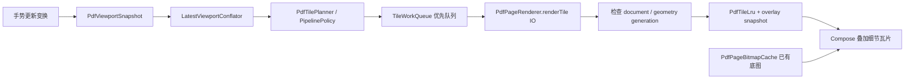

# 06 PDF 子系统

[返回目录](README.md)

## 职责分工

PDF 是工程中最复杂的子系统。平台 `android.graphics.pdf.PdfRenderer` 负责位图；PDFBox Android 负责大纲、文本、页提取、批注输出、有限正文编辑与工具操作。项目没有把 PDFium 或 Readium 作为当前主阅读后端。

| 层 | 关键入口 | 负责什么 |
|---|---|---|
| 会话状态 | [PdfViewerViewModel](../../app/src/main/java/com/m1racle/reader/ui/pdf/PdfViewerViewModel.kt) | 打开、页缓存、瓦片调度、模式/位置、目录、导出、关闭 |
| 主页面 | [PdfViewerScreen](../../app/src/main/java/com/m1racle/reader/ui/pdf/PdfViewerScreen.kt) | 模式切换、chrome、阅读与选择交互 |
| 连续视口 | [ContinuousDocumentViewport](../../app/src/main/java/com/m1racle/reader/ui/pdf/ContinuousDocumentViewport.kt) | 连续页面绘制、视口观测与变换连接 |
| 位图后端 | [PdfPageRenderer](../../app/src/main/java/com/m1racle/reader/pdf/PdfPageRenderer.kt) | 安全打开、单页/瓦片渲染、异步关闭 |
| 几何/手势 | `ContinuousDocumentGeometry`、`PdfGestureTransformController`、`ZoomPanPhysics` | 坐标变换、边界、缩放焦点、拖动、fling 与 spring |
| 缓存/流水线 | `PdfPageBitmapCache`、`PdfTileLru`、`TileWorkQueue` | 低清底图与细节瓦片、优先级、预算、generation |
| 数据 | `DocumentRepository`、`FinalPdfProgressFlusher` | 原子位置快照、进度最终写入 |

## 打开和资源生命周期

`PdfPageRenderer.open(uriString)` 返回 `OpenResult.Success(pageCount)` 或 NotFound/PermissionDenied/Failed。`pageSizePts()` 提供页面真实比例，`renderPage()`/`renderTile()` 返回具名成功/关闭/越界/OOM/失败结果。内部 `Mutex` 保护平台 renderer，重型操作在 IO 执行。

资源顺序由 [PdfResourceCloseOrder](../../app/src/main/java/com/m1racle/reader/pdf/PdfResourceCloseOrder.kt) 明确表达：先关闭页面使用，renderer 先于 ParcelFileDescriptor 关闭；FD 需在构造 renderer 前记录，保证构造失败也能关闭 FD。文档切换还要关闭缩略图后端、清空页/瓦片缓存、提升 document generation 后再打开新内容。

`PdfViewerViewModel.onCleared()` 在应用级 scope 启动最终写入/关闭，避免主线程 `runBlocking` 等待锁。进入正文编辑前调用 `releaseForEditing()`，完成释放后才替换导航，防止读取会话与写入会话重叠。

## 阅读模式与几何

[PdfReadingMode](../../app/src/main/java/com/m1racle/reader/pdf/PdfReadingMode.kt) 只有 VERTICAL_CONTINUOUS 与 HORIZONTAL_PAGED；上一页/下一页按钮是 chrome 选项，不是第三种渲染模式。

- 连续模式使用全书布局坐标、各页高宽比和 page gap，由 `ContinuousDocumentGeometry` 计算页 top、高度、可见页范围、scroll bounds 和 viewport anchor。
- 横向模式使用 `ThreePageStrip` 等页带/横向几何辅助；手势仍连接公共变换控制器与物理策略。
- `PdfGestureTransformController.beginGesture/pointerFrame/endGesture()` 处理指针阶段；platform fling 和 spring 使用 generation，打断旧运动后不得继续应用旧帧。
- `zoomAt()` / `zoomAndPanFromFocal()` 保持缩放焦点；`restoreViewportSession()` 还原归一化锚点；`remapStatePreservingViewportTop()` 在真实页面比例补齐时保持视口连续。

模型包括 PDF 点坐标、页面布局坐标、文档坐标、视口坐标、瓦片像素坐标。不能用 bitmap 像素尺寸替代页面布局尺寸，否则清晰度升级会改变页面几何。

## 底图与瓦片流水线

关键策略在 [PdfTileRendering](../../app/src/main/java/com/m1racle/reader/pdf/PdfTileRendering.kt)、[PdfTilePipeline](../../app/src/main/java/com/m1racle/reader/pdf/PdfTilePipeline.kt) 与 [TileWorkQueue](../../app/src/main/java/com/m1racle/reader/pdf/TileWorkQueue.kt)。

- tile 核心尺寸 512 px，bleed 2 px；键中包含文档、页、缩放桶与几何世代等维度。
- 优先级为 FOCUS/CENTER/VISIBLE/LEADING_EDGE/NEAR/PAGE_AHEAD/MARGIN/SPECULATIVE，先满足当前可见区域，再预测移动方向。
- planner 和发布批次策略各约 16 ms；用最新视口合并避免排队过时快照。这些是策略常量，不是每台设备的性能保证。
- `PdfTileLru` 默认 56 MiB，结合 pinned keys 避免淘汰当前关键瓦片；淘汰后需要同步清理 overlay 引用。
- 页缓存使用 preview/high 档位与 generation。`putIfCurrent()` 拒绝旧结果，成功替换前保留 last-good bitmap。默认 HIGH 预算 1 页，但被保护的可见页可暂时超过预算。
- `PdfRenderQuality` 使用 px 桶、迟滞与闲置升级；连续底图宽度上限 3,072 px。不要把 renderer 总安全上限和连续模式策略上限混为一谈。

`DisplayedBitmapRetentionPolicy`、`BitmapAllocationGuard`、缩略图缓存和 OOM 处理共同防止黑页/闪页/过量内存，性能与视觉仍需真实设备测试。

## 进度、模式切换与书签

`PdfViewportSessionState` 保存模式、页、归一化页内/视口锚点、scale 和 generation。`PdfViewportSessionTracker` 区分 preview 与 stable，只有稳定状态才作为普通持久化依据。

`PdfViewerViewModel.commitViewportSession()` 与 `commitContinuousDocumentState()` 更新稳定读点；`FinalPdfProgressFlusher.flush()` / `sealAndFlushFinal()` 序列化普通/最终写入，交给 `updatePdfProgressSnapshotAtomic()` 一次保存相关字段。普通 PDF 持久化调度使用 350 ms 防抖。

模式切换应从 canonical anchor 派生目标视口，不能简单复用另一坐标系的像素偏移。书签通过 `BookmarkTarget` 捕获指定读点和视口，打开时覆盖最新进度目标。

## 文字选择、大纲与印刷页

[PdfTextSelection](../../app/src/main/java/com/m1racle/reader/pdf/PdfTextSelection.kt) 用 PDFBox 提取当前页文字与几何，检查内容提取权限；UI 的 `PdfHighlightGeometry`/`PdfHighlightLayer` 转为归一化多矩形并绘制。没有文本层的扫描件不能据此获得 OCR。

`PdfEmbeddedOutlineParser` 读取嵌入目录，`PdfEmbeddedOutlineImporter.buildReplace/buildMerge()` 生成可持久化节点，并识别导入来源。`TextbookOutlineResolver` 处理业务目录层级和页区间。`PrintPageResolver` 通过人工校准锚点推导印刷页；PDF 页索引始终零基，展示页通常一基，印刷页是另一套语义。

## 章节/标注导出

| 入口 | 行为 |
|---|---|
| `ExportRangeResolver` | 验证并确定节点/当前章节的零基闭区间和输出名称 |
| `PdfPageExtractor` | 提取指定页范围并复制有关元数据 |
| `ChapterPackageExporter.export()` | 生成 ZIP：`source.pdf`、`manifest.json`、`outline.json`、`page_map.json`、`checksums.json` |
| `PdfAnnotatedExporter.export()` | 输出含支持的阅读批注的 PDF |
| `ExportCancellationToken` / `ExportCancellationIo` | 流复制中的取消检查、目的地/临时文件尽力清理 |

`checksums.json` 只覆盖另外四个文件，避免自哈希循环。目录和页码映射明确标注源/导出的一基页号与零基索引。输出流成功关闭是目的地提交边界；取消之前清理 SAF 目的地是 best effort，具体 provider 行为无法由本地事务保证。

## 有限 PDF 正文编辑

[PdfBodyEditor.inspect(source, pageIndex)](../../app/src/main/java/com/m1racle/reader/pdf/edit/PdfBodyEditor.kt) 提取可编辑文字 run，以 `PdfTextKey(page, operator)` 标识。`writeCopy(source, output, edits)` 修改副本中的文字操作符，保存后重新解析验证结果。编辑不是覆盖一层新文字，也不是 OCR 或自动重排。

拒绝条件包括加密/签名文件、不支持的内容结构、字体无法编码新文字、复杂字符排版、文字超出原行宽等；当前单个替换文本要求 1–2,048 个可见字符，不支持以空串删除 run。UI 会话还限制修改数量和总字符数。

[PdfBodyEditorViewModel](../../app/src/main/java/com/m1racle/reader/ui/pdf/edit/PdfBodyEditorViewModel.kt) 管理原件、编辑集合、预览、保存当前或另存。`DocumentRepository.saveDocumentEdits()` 验证预期内容哈希，更新读取副本及身份；需要外部写回时，[PdfSourceWriteStore](../../app/src/main/java/com/m1racle/reader/pdf/edit/PdfSourceWriteStore.kt) 先保存 original.pdf 与 AtomicFile 日志，再核对源哈希、替换、核对输出哈希，失败尝试恢复。

启动恢复按数据库是否提交、源当前哈希和票据状态处理；检测到第三方再次修改时保留备份并拒绝自动覆盖。该流程不应被描述为跨文件系统与 SQLite 的天然原子事务。

关键测试按 renderer、几何/手势、瓦片、位置 flush、目录、导出和编辑分组，见 [测试索引](reference/test-index.md)。进一步的技术接手说明见 [PDF_VIEWER_HANDOFF](../PDF_VIEWER_HANDOFF.md)，历史交接内容须结合当前源码复核。
