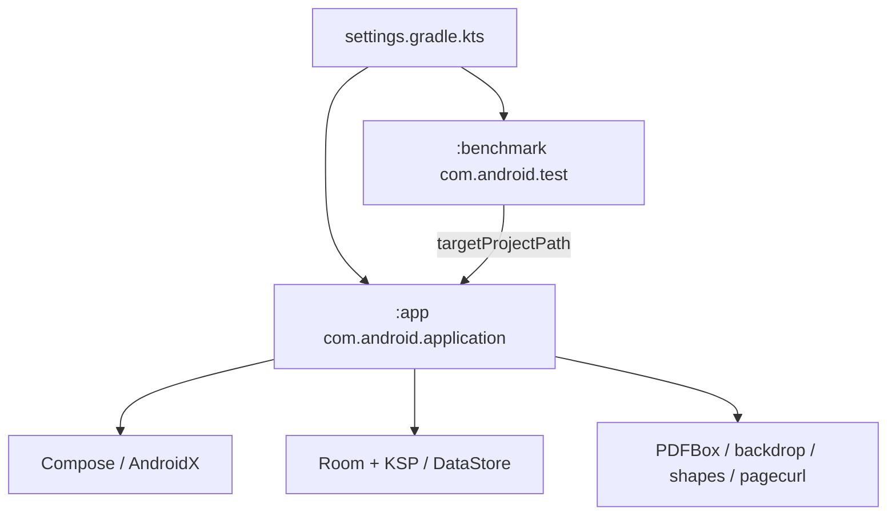

# 09 依赖关系

[返回目录](README.md)

以下版本直接来自仓库 Gradle 文件，记录当前工程配置，不主张它们是上游最新版本。本次没有升级依赖。

## Gradle 模块与插件

| 配置 | 版本/值 | 来源 |
|---|---|---|
| Gradle Wrapper | 9.5.0 | [wrapper properties](../../gradle/wrapper/gradle-wrapper.properties) |
| AGP application/test | 9.1.1 | [根构建](../../build.gradle.kts) |
| Kotlin compiler / Compose plugin | 2.3.21 | 根构建；AGP 内置 Kotlin |
| KSP | 2.3.6 | 根构建 |
| Java/Kotlin JVM target | 17 | app/benchmark 构建配置 |
| compileSdk / buildTools | 37 / 36.0.0 | [app 构建](../../app/build.gradle.kts) |
| minSdk / targetSdk | 31 / 35 | app/benchmark 构建配置 |

仓库优先使用 google、Maven Central 和插件门户，阿里镜像为后备。`FAIL_ON_PROJECT_REPOS` 让依赖仓库集中在 settings。首次准备依赖需要可用网络或完整预热缓存。

## 应用运行依赖

| 依赖 | 配置版本 | 作用 |
|---|---|---|
| `androidx.compose:compose-bom` | 2026.05.00 | 管理 UI、Material3、icons 等 Compose 组件版本；各组件未逐个写死 |
| `androidx.activity:activity-compose` | 1.9.3 | Activity 与 Compose 集成 |
| Lifecycle runtime/viewmodel/runtime-compose | 2.8.7 | 页面生命周期、ViewModel、Flow UI 订阅 |
| Navigation Compose | 2.8.5 | NavHost/路由/恢复 |
| Room runtime/ktx/compiler | 2.7.2 | SQLite 数据层；compiler 经 KSP 运行 |
| Coroutines Android | 1.9.0 | suspend、Flow、后台工作与 scope |
| DataStore Preferences | 1.1.1 | 阅读与 EPUB 设置 |
| `com.tom-roush:pdfbox-android` | 2.0.27.0 | PDF 解析、大纲、文字、编辑、提取、导出与工具 |
| `io.github.kyant0:backdrop` | 2.0.0 | 玻璃背景采样与光学效果 |
| `io.github.kyant0:shapes` | 1.2.0 | 支持的光学形状几何 |
| `io.github.oleksandrbalan:pagecurl` | 1.5.1 | EPUB 卷页组件 |
| `desugar_jdk_libs` | 2.1.5 | coreLibraryDesugaring，支持使用的 JDK 库 API |

平台 PdfRenderer、SAF、PdfDocument、Bitmap 等属于 Android SDK，不能把它们列作 Maven 下载库。没有联网图片库、云服务 SDK 或 Markdown 浏览器引擎依赖。

## 测试与性能依赖

| 依赖 | 版本 | 用途 |
|---|---|---|
| JUnit4 | 4.13.2 | JVM 测试 |
| Coroutines Test | 1.9.0 | 协程时序、取消与调度测试 |
| Robolectric | 4.14.1 | JVM Android/Compose 测试 |
| Compose ui-test-junit4 / ui-test-manifest | BOM 管理 | UI 语义、规则和测试 Activity |
| AndroidX Test Core / Ext JUnit | 1.6.1 / 1.2.1 | 测试基础与 runner |
| SQLite JDBC | 3.45.3.0 | 主机上运行真实 SQL 迁移语句；仅 testImplementation |
| Room Testing | 2.7.2 | Android 迁移/数据库验证 |
| Espresso / UiAutomator | 3.6.1 / 2.3.0 | benchmark 操作设备 |
| Macrobenchmark | 1.3.3 | 冷启动与帧时序 |

`testBuildType=qa` 控制仪器测试目标，也影响 AGP 9 默认创建的 JVM 测试组件。本轮另通过 beforeVariants 显式启用 Release 单测；`testQaUnitTest` / `testReleaseUnitTest` 分别选择相应变体，不会把手动调用的所有单测任务重定向为 QA。

## 内部依赖的实际形态

| 发起包 | 关键依赖与原因 |
|---|---|
| 根包/Application | data、identity、share；组装进程级对象 |
| `ui/navigation` | 各 Screen/ViewModel、三类仓库、anchor、share；路由与会话连接 |
| `data/repository` | local、anchor、identity、share、markdown、epub、pdf、packageimport；业务与持久化边界 |
| `data/anchor` | local 及 PDF viewport/mode；书签快照并非完全平台无关 |
| `identity` | local DAO、share 的元数据类型、文件流与 SHA-256 |
| `share` | repository、local、identity；协调外部打开与最终提交 |
| `ui/viewer` / `search` | Markdown model、解析/搜索、数据与控制器 |
| `ui/pdf` | pdf 引擎、repository、reader/annotation、material |
| `ui/epub` | epub 模型、settings、repository、Compose pager 与 pagecurl |
| `ui/material` | Android/Compose、backdrop/shapes；不拥有文档身份或阅读位置 |

这是包级耦合图，不能包装成独立模块的严格单向层级。完整显式 import 邻接表由工具生成在 [包依赖索引](reference/package-dependencies.md)；同包引用、完全限定名、运行时回调和反射不包含在该统计内。

## 构建与打包约束

Release 开启 R8 minify 与资源 shrink，规则见 [proguard-rules.pro](../../app/proguard-rules.pro)。PDFBox 的反射使用等需要相应 keep 规则。打包排除少量未使用的 BouncyCastle PQC 参数资源，不代表移除了整个加密依赖。

APK 由 AGP 完成对齐与签名，不应再用 jarsigner 重签；这可能破坏未压缩 native library 的 16 KiB 对齐。变体能力与签名门禁见 [运行手册](10-build-and-run.md)。
